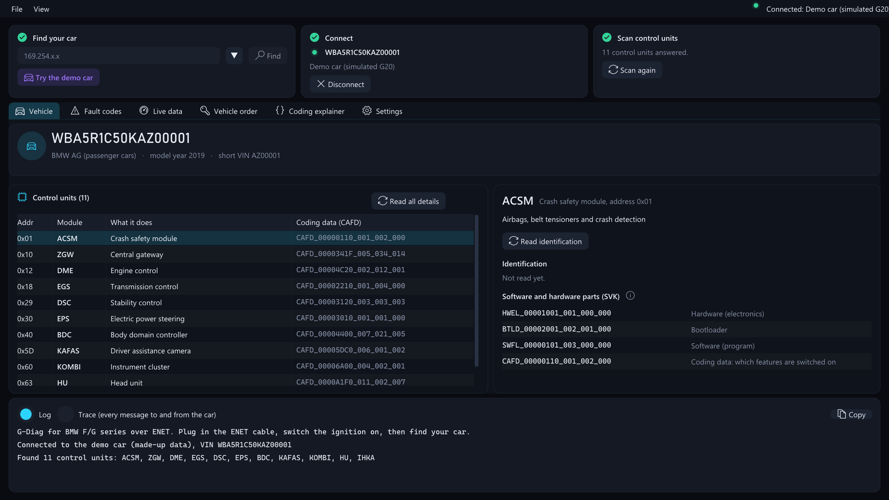
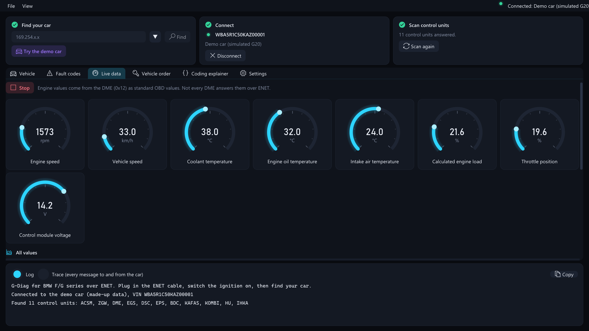
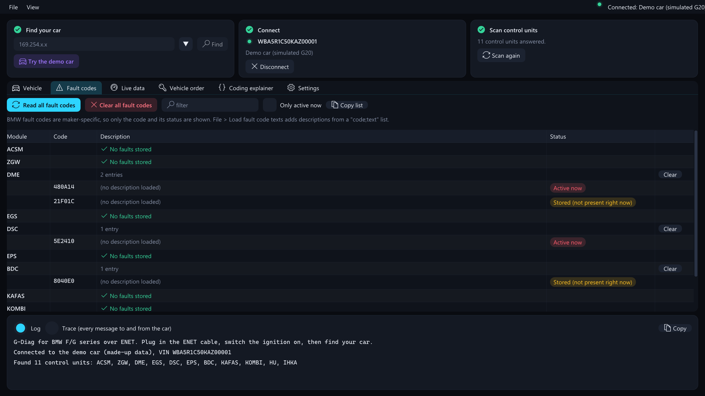
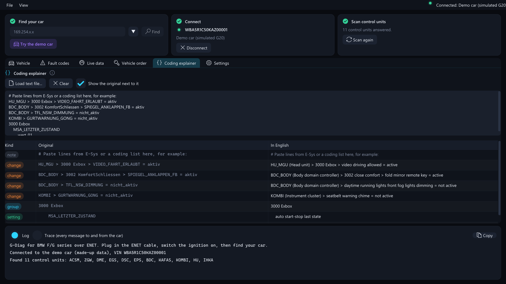

# G-Diag — BMW F/G series diagnostics in plain English

An ImGui diagnostic app for BMW F, G (and early U) series cars over an **ENET cable**, for macOS and Windows.
It is the BMW counterpart of [Diogenes-ImGui](https://github.com/Unblonded/Diogenes-ImGui/tree/macos), which does
the same job for Mercedes-Benz. The idea is the same: talk to the car's control units directly and explain what
comes back in plain English instead of German abbreviations and hex.



## What's different from the Mercedes version

| | Diogenes-ImGui (Mercedes) | G-Diag (BMW) |
|---|---|---|
| Cable | J2534 pass-through (OpenPort, Macchina) + a driver | ENET (Ethernet to OBD). **No driver**, works the same on every OS |
| Protocol | KWP2000 / UDS over CAN, via the J2534 driver | UDS over HSFZ (TCP 6801, UDP 6811 discovery), built in |
| Data files | One CBF per control unit, loaded by the user | Not needed to read modules, faults and live data |
| German in | CBF names and texts | Coding (FDL) parameter names, explained in the Coding tab |

## Features

- **Find your car** on the network (UDP broadcast, like E-Sys and ISTA do), or type its address.
- **Vehicle**: VIN decode, every control unit that answers with what it does, part numbers, and its
  SVK software list (hardware, bootloader, software and the CAFD coding file) with each part explained.
- **Fault codes**: read every module at once, status spelled out ("Active now", "Stored"), clear per module or all.
  BMW codes are maker-specific, so descriptions come from a `code;text` list you load (File > Load fault code texts).
- **Live data**: instrument-cluster style gauges for engine values (DME, standard OBD values via UDS `22 F4xx`),
  history sparklines, and your own DIDs with scale/offset/unit.
- **Vehicle order (FA)**: open an E-Sys/ISTA FA (XML or `G020#0719*5U31$205...` text) and see the series,
  build date, paint and every option code with its name.
- **Coding explainer**: paste lines from E-Sys or a coding guide
  (`BDC_BODY > 3002 KomfortSchliessen > SPIEGEL_ANKLAPPEN_FB = aktiv`) and get
  `BDC_BODY (Body domain controller) > 3002 close comfort > fold mirror remote key = active`.
  It only reads text, nothing goes to the car.
- **Console** (View > Advanced mode): raw UDS to any module. Reads go straight out; anything that could change the car
  asks twice, with the "yes" button locked for 3 seconds.
- **Demo car**: a simulated G20 to try everything without a car (`--demo`, or File > Connect to the demo car).





## Connecting to a car

1. An ENET cable. G series cars need the activation resistor between OBD pins 8 and 16, which nearly every ENET cable has.
2. Ignition on (Start without the brake). Use a battery charger for long sessions.
3. Leave the Ethernet adapter on "automatic" (DHCP). With no DHCP server, the computer and the car both pick a
   `169.254.x.x` address after a few seconds.
4. Press **Find**, then **Connect**. The scan starts automatically.

On macOS the first connection may ask for Local Network permission. Allow it.

## Command line

```
GDiag --demo                         start connected to the simulated car
GDiag --sim-server [port]            serve the simulated car over real HSFZ on 127.0.0.1 (default 6801)
GDiag --discover                     list cars on the network
GDiag --scan 169.254.12.34[:port]    list modules, CAFDs and fault codes without opening a window
GDiag --translate "SPIEGEL_ANKLAPPEN_FB"
GDiag --demo --screenshot out.png --tab live    render one frame to a PNG and quit
```

## Building

Needs the .NET 8 SDK.

```
dotnet run --project GDiag -- --demo     # run
dotnet test                              # 19 tests: HSFZ client against the simulator over TCP, parsers, translator
mac/build-app.sh                         # G-Diag.app for Apple silicon (osx-x64 for Intel)
```

GitHub Actions runs the tests, builds the Mac and Windows zips and publishes them as a release on every push to `main` (`v1.0.<run number>`). Push a tag like `v2.0.0` to release under that name instead.

## Layout

- `GDiag/Net`: HSFZ framing and client, UDP discovery, the simulated car and its HSFZ server
- `GDiag/Uds`: UDS requests (response-pending handling, negative response texts) and fault code parsing
- `GDiag/Bmw`: module addresses, SVK parsing, FA parsing and option names, VIN decode, live value definitions
- `GDiag/Translation`: the German→English translator from Diogenes-ImGui plus BMW coding vocabulary
- `GDiag/UI`: the ImGui tabs (theme, fonts and widgets are from Diogenes-ImGui)

## Status and limits — read before using on a car

- **Not yet tested on a real car.** The HSFZ and UDS code is tested end to end against the built-in simulator, which
  follows the protocol as documented by the open-source BMW tooling community. Real gateways may differ in details,
  especially the alive-check handling and which DIDs each module answers.
- The module list is the usual F/G series addresses. Variants differ; "Scan every address" in Settings finds the rest.
- The SVK parser assumes the common layout (count, then 8 bytes per entry). Units that report differently show no parts list.
- Many DMEs do not answer the standard OBD values over ENET; those gauges then show "-".
- **No coding writes and no flashing.** Changing coding safely needs the CAFD files and E-Sys' checks. This app explains
  coding; use E-Sys or BimmerCode to change it.
- DoIP (port 13400, used by the newest U/G series gateways) is not implemented yet; those cars still answer HSFZ on most models.

Use at your own risk. Clearing fault codes or sending raw requests to a car can have consequences.
Not affiliated with BMW AG. BMW, E-Sys and ISTA are trademarks of their owners.

## License

MIT. Parts come from Diogenes-ImGui / CaesarSuite (MIT, © 2020 JinGen Lim), see [LICENSE](LICENSE).
Material Icons font: Apache 2.0, see `GDiag/Fonts/MaterialIcons-LICENSE.txt`.
